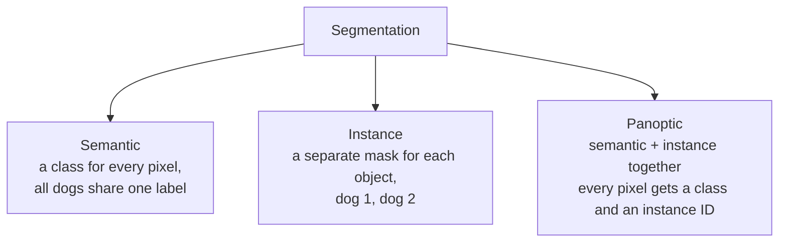
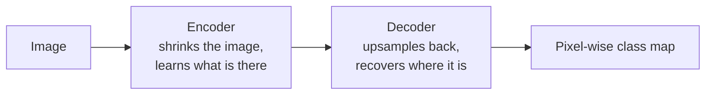
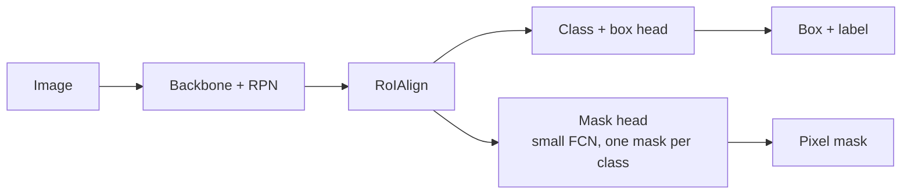

# Computer Vision · 7. Image Segmentation

> Roadmap status: Learn ☐ Project ☐ Revision ☐
> **Prerequisites:** 02_image_processing.md, 03_object_detection.md, CNN basics (convolution, pooling)

## 1. What is it?
**Image segmentation** assigns a label to **every pixel** of an image. Object detection draws a box around an object; segmentation gives its **exact shape**.

```
Detection (box)           Segmentation (pixel mask)
┌──────────┐              . . . . . . . . .
│  ╭───╮   │              . . . ■ ■ ■ . . .
│  │dog│   │              . . ■ ■ ■ ■ ■ . .
│  ╰───╯   │              . . ■ ■ ■ ■ ■ . .
└──────────┘              . . . . ■ . . . .      ■ = pixels of "dog"
```

## 2. Three kinds of segmentation

| Type | Answers | Example output |
|---|---|---|
| **Semantic** | "What class is this pixel?" | Road, sky, person, car (two cars merge into one "car" region) |
| **Instance** | "Which object does this pixel belong to?" | Car #1 mask, car #2 mask (background ignored) |
| **Panoptic** | Both | "Stuff" (road, sky) as semantic regions + "things" (cars, people) as instances |

The output of semantic segmentation is a **mask**: an `H × W` array where each value is a class ID.
```
Class map (H × W)
0 0 0 0 0 0        0 = background
0 1 1 1 0 0        1 = person
0 1 1 1 2 2        2 = bicycle
0 0 1 1 2 2
```

## 3. Classical (non-deep-learning) methods
These work with the image-processing tools from file 02 and need no training data.
| Method | Idea | OpenCV |
|---|---|---|
| **Thresholding / Otsu** | Split by brightness | `cv2.threshold` |
| **Color range (HSV)** | Keep pixels within a color range | `cv2.inRange` |
| **K-means on color** | Cluster pixels into K color groups | `cv2.kmeans` |
| **Watershed** | Treat intensity as terrain and flood from markers to split touching objects | `cv2.watershed` |
| **GrabCut** | You draw a box, it separates foreground from background | `cv2.grabCut` |
| **Contours** | Outline shapes on a binary image | `cv2.findContours` |

Good for simple backgrounds, controlled lighting, and quick prototypes. Weak on messy real-world scenes.

## 4. Deep learning approaches
### Semantic segmentation: encoder-decoder idea

- **Encoder:** convolution + pooling reduce size and build meaning (like a classifier backbone).
- **Decoder:** upsampling (bilinear interpolation or **transposed convolution**) restores full resolution.

### Key architectures
| Model | Key idea |
|---|---|
| **FCN** (Fully Convolutional Network) | Replace the final fully connected layers with convolutions so the network accepts any image size and outputs a map. The starting point of deep segmentation |
| **U-Net** | Encoder-decoder with **skip connections** that copy detail from encoder to decoder. Very popular in medical imaging and works with small datasets |
| **DeepLab** | **Atrous (dilated) convolution** to see a wide area without losing resolution, plus ASPP to combine multiple scales |
| **PSPNet** | Pyramid pooling to use global context |
| **Mask R-CNN** | Faster R-CNN + a **mask branch** and RoIAlign: the standard instance segmentation method |
| **YOLO-seg** | YOLO detectors extended with mask output: fast instance segmentation |
| **SAM** (Segment Anything) | A promptable foundation model: give a point, box or text-like prompt and it outputs a mask. SAM 2 extends this to video |

### U-Net at a glance
```
Input ─► [conv] ─► [conv] ──────────────────── skip ───────────► [concat] ─► [conv] ─► Output mask
              ↓ pool                                                  ↑ upsample
           [conv] ─► [conv] ──────────── skip ────────► [concat] ─► [conv]
                 ↓ pool                                      ↑ upsample
                      [conv] ─► [conv]   (bottleneck: smallest, most abstract) 
```
The **skip connections** matter: the decoder gets fine edges from early layers and meaning from deep layers.

### Instance segmentation (Mask R-CNN)


## 5. Loss functions
| Loss | Use |
|---|---|
| **Pixel-wise cross-entropy** | Standard multi-class segmentation |
| **Dice loss** | `1 − Dice`. Handles imbalance, where background pixels dominate |
| **Focal loss** | Down-weights easy pixels, focuses on hard ones |
| **IoU (Jaccard) loss** | Directly optimizes overlap |
| **Combined** | Cross-entropy + Dice is a common recipe |

## 6. Evaluation metrics
```
IoU  (Jaccard) = |A ∩ B| / |A ∪ B|
Dice (F1)      = 2·|A ∩ B| / (|A| + |B|)
Pixel accuracy = correct pixels / all pixels     (misleading when background dominates)
mIoU           = IoU averaged over classes
```
- Instance segmentation uses **mask AP** (like box AP, but IoU is computed on masks).
- Panoptic segmentation uses **PQ (Panoptic Quality)**.
- Example of why pixel accuracy misleads: if 95% of pixels are background, predicting "all background" scores 95% accuracy but finds nothing. Always report **IoU or Dice**.

## 7. Datasets
| Dataset | Notes |
|---|---|
| **COCO** | Instance and panoptic masks, 80 object classes |
| **Pascal VOC** | Classic semantic benchmark |
| **Cityscapes** | Urban street scenes for driving |
| **ADE20K** | Wide scene parsing with many classes |
| **Medical sets** | CT, MRI, microscopy (usually small, so U-Net is common) |
| **Your own** | Label masks with tools such as CVAT, Label Studio or Roboflow |

## 8. Hands-on code
### Classical: GrabCut (OpenCV)
```python
import cv2, numpy as np

img  = cv2.imread("photo.jpg")
mask = np.zeros(img.shape[:2], np.uint8)
bgd, fgd = np.zeros((1, 65), np.float64), np.zeros((1, 65), np.float64)
rect = (50, 50, 300, 400)                          # (x, y, w, h) box around the object

cv2.grabCut(img, mask, rect, bgd, fgd, 5, cv2.GC_INIT_WITH_RECT)
fg = np.where((mask == 1) | (mask == 3), 255, 0).astype("uint8")
cut = cv2.bitwise_and(img, img, mask=fg)
cv2.imwrite("cutout.png", cut)
```

### Instance segmentation with YOLO (Ultralytics)
```python
from ultralytics import YOLO

model = YOLO("yolov8n-seg.pt")                     # segmentation variant of a small model
results = model("street.jpg")
r = results[0]
print(r.masks.data.shape)                          # (num_objects, H, W) binary masks
results[0].save("seg.jpg")                         # image with masks drawn
```

### Semantic segmentation with torchvision (DeepLabV3)
```python
import torch
from torchvision.io import read_image
from torchvision.models.segmentation import deeplabv3_resnet50, DeepLabV3_ResNet50_Weights

w = DeepLabV3_ResNet50_Weights.DEFAULT
model = deeplabv3_resnet50(weights=w).eval()
prep = w.transforms()

img = read_image("street.jpg")
with torch.no_grad():
    out = model(prep(img).unsqueeze(0))["out"]      # (1, num_classes, H, W)
mask = out.argmax(1)[0]                             # (H, W) class ID per pixel
print(mask.unique())
```

### Dice and IoU from scratch
```python
import numpy as np

def dice(pred, truth):                              # binary masks (H, W)
    inter = (pred & truth).sum()
    return 2 * inter / (pred.sum() + truth.sum() + 1e-9)

def iou(pred, truth):
    inter = (pred & truth).sum()
    union = (pred | truth).sum()
    return inter / (union + 1e-9)
```

## 9. Tips
- **Augment carefully:** flips, crops, brightness changes, and apply the **same** transform to image and mask.
- Resize masks with **nearest-neighbor** interpolation, never bilinear, or class IDs get corrupted.
- With heavy class imbalance, use Dice or focal loss.
- Check predictions visually on overlays, not only metrics.
- Segmentation labels are expensive: consider SAM-assisted labeling, then fix the results by hand.

## 10. Common mistakes
- Using bilinear interpolation on a mask.
- Reporting only pixel accuracy.
- Mismatched sizes between image and mask after resizing.
- Mixing up semantic masks (class IDs) with instance masks (one mask per object).
- Forgetting `model.eval()` for inference.

## 11. Interview questions
1. Semantic vs instance vs panoptic segmentation?
2. How is segmentation different from object detection?
3. Why do segmentation networks need a decoder?
4. What are skip connections in U-Net and why do they help?
5. What is atrous (dilated) convolution?
6. How does Mask R-CNN extend Faster R-CNN?
7. IoU vs Dice: formulas and when each is used?
8. Why is pixel accuracy a poor metric for imbalanced classes?
9. What is SAM and how is it different from a trained-per-task model?

## 12. Checklist for this topic
- [ ] **Learn**: the three types, encoder-decoder, U-Net skip connections, Mask R-CNN, Dice/IoU, mIoU
- [ ] **Project**: remove or replace image backgrounds using GrabCut, then try YOLO-seg on the same images
- [ ] **Project (extra)**: train a small U-Net on a public segmentation dataset and report mIoU and Dice
- [ ] **Revision**: answer the 9 interview questions without notes

## 13. Resources
- FCN: https://arxiv.org/abs/1411.4038
- U-Net: https://arxiv.org/abs/1505.04597
- DeepLabV3: https://arxiv.org/abs/1706.05587
- Mask R-CNN: https://arxiv.org/abs/1703.06870
- Panoptic Segmentation: https://arxiv.org/abs/1801.00868
- Segment Anything: https://arxiv.org/abs/2304.02643
- OpenCV tutorials (watershed, GrabCut): https://docs.opencv.org/4.x/d6/d00/tutorial_py_root.html
