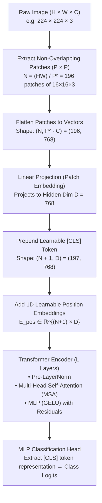

# Computer Vision · 8. Vision Transformers (ViT)

> Roadmap status: Learn ☐ Project ☐ Revision ☐  
> **Prerequisites:** CNN basics (convolution, receptive fields), Attention mechanism, 03_object_detection.md, Transformers / Tokenization

---

## 1. What is a Vision Transformer?

For years, Convolutional Neural Networks (CNNs) were the undisputed backbone of computer vision. In 2020, Dosovitskiy et al. introduced **Vision Transformer (ViT)** in the landmark paper:
> *"An Image is Worth 16x16 Words: Transformers for Image Recognition at Scale"*

ViT showed that the standard Transformer architecture—originally designed for natural language processing—can be applied directly to sequences of image patches **without convolutional layers**, matching or outperforming state-of-the-art CNNs when pre-trained on large-scale datasets.

```
       Standard NLP Transformer                  Vision Transformer (ViT)
    ┌─────────────────────────────┐           ┌─────────────────────────────┐
    │  "The", "cat", "sat", ...   │           │  [16x16 Patch 1, Patch 2..] │
    │              ↓              │           │              ↓              │
    │      Word Embeddings        │           │    Linear Patch Projection  │
    │              ↓              │           │              ↓              │
    │     Position Embeddings     │           │    1D Position Embeddings   │
    │              ↓              │           │              ↓              │
    │   Transformer Encoder (MSA) │           │   Transformer Encoder (MSA) │
    └─────────────────────────────┘           └─────────────────────────────┘
```

---

## 2. ViT Architecture & Dataflow



### Detailed Pipeline Breakdown

1. **Patch Extraction & Flattening:**
   An image $\mathbf{x} \in \mathbb{R}^{H \times W \times C}$ is split into a grid of non-overlapping patches $\mathbf{x}_p \in \mathbb{R}^{N \times (P^2 \cdot C)}$, where:
   - $P$ is the patch size (typically $16 \times 16$ or $14 \times 14$).
   - $N = \frac{H \cdot W}{P^2}$ is the resulting sequence length (e.g., $\frac{224 \times 224}{16 \times 16} = 196$).
   - $P^2 \cdot C = 16 \times 16 \times 3 = 768$ features per flattened patch.

2. **Linear Patch Projection:**
   Each flattened patch vector is multiplied by a learnable projection matrix $\mathbf{E} \in \mathbb{R}^{(P^2 \cdot C) \times D}$ to map it into latent dimension $D$ (equivalent to a 2D convolution with kernel size $P$, stride $P$).

3. **`[CLS]` Class Token:**
   Similar to BERT, a learnable token $\mathbf{x}_{\text{class}} \in \mathbb{R}^{1 \times D}$ is prepended to the sequence of patch embeddings. Its state at the output of the Transformer serves as the image-level representation for classification.

4. **Position Embeddings:**
   Because self-attention is permutation-invariant, 1D learnable position embeddings $\mathbf{E}_{\text{pos}} \in \mathbb{R}^{(N+1) \times D}$ are added element-wise to the patch embeddings to retain spatial order:
   $$\mathbf{z}_0 = [\mathbf{x}_{\text{class}}; \mathbf{x}_p^1 \mathbf{E}; \mathbf{x}_p^2 \mathbf{E}; \dots; \mathbf{x}_p^N \mathbf{E}] + \mathbf{E}_{\text{pos}}$$

5. **Transformer Encoder Blocks ($L$ layers):**
   Each block uses pre-norm residual connections:
   $$\mathbf{z}'_\ell = \text{MSA}(\text{LN}(\mathbf{z}_{\ell-1})) + \mathbf{z}_{\ell-1}$$
   $$\mathbf{z}_\ell = \text{MLP}(\text{LN}(\mathbf{z}'_\ell)) + \mathbf{z}'_\ell$$

6. **MLP Head:**
   The output vector corresponding to $\mathbf{z}_L^0$ (`[CLS]` token) is fed into a linear layer (or MLP) to output class probabilities via softmax.

---

## 3. Mathematical Foundations: Self-Attention in Vision

In Self-Attention, every patch attends to every other patch in the entire image simultaneously from layer 1:

$$\text{Attention}(Q, K, V) = \text{softmax}\left(\frac{Q K^T}{\sqrt{d_k}}\right) V$$

Where $Q = Z W_Q$, $K = Z W_K$, $V = Z W_V$ are projections of the patch representations with dimension $d_k = D / h$ per attention head.

### Computational Complexity: ViT vs CNN

| Property | Convolutional Layer (CNN) | Self-Attention Layer (ViT) |
|---|---|---|
| **Receptive Field** | Local (grows linearly with depth $O(L)$) | **Global immediately** ($O(1)$ depth) |
| **Computational Complexity** | $\mathcal{O}(K^2 \cdot C_{\text{in}} \cdot C_{\text{out}} \cdot H \cdot W)$ | $\mathcal{O}(N^2 \cdot D) = \mathcal{O}\left(\frac{H^2 W^2}{P^4} \cdot D\right)$ |
| **Scaling with Resolution** | Linear with pixel count $\mathcal{O}(H \cdot W)$ | **Quadratic** with patch count $\mathcal{O}(N^2)$ |
| **Inductive Bias** | Strong (translation equivariance & locality) | **Weak** (must learn 2D geometry from data) |

---

## 4. CNN vs Vision Transformer: Inductive Bias & Scaling

```
  Performance
      ▲
      │                                       ViT (Large Data / JFT-300M)
      │                                   . ─ '
      │                              . ─ '
      │                     CNN  . ─ '
      │               . ─ ─ ─ ─ ─ ─ ─ ─ ─ ─ ─ ─ (CNN plateau)
      │          . ─ '
      │     . ─ '
      │. ─ '   ViT (Small Data / ImageNet-1K without pretraining fails)
      └─────────────────────────────────────────────────────────────►
                       Dataset Size / Scale
```

- **CNNs have high inductive bias:** They inherently assume nearby pixels are correlated (locality) and that patterns are identical across locations (translation equivariance). Hence, CNNs learn quickly on small datasets.
- **ViTs have low inductive bias:** They treat image patches like an arbitrary bag of tokens. They must learn spatial relationships from scratch.
- **The Trade-Off:** On small datasets (e.g., ImageNet-1k trained from scratch), ViT underperforms ResNet. But when pre-trained on massive datasets (ImageNet-21k, JFT-300M), ViT's capacity dominates without saturating.

---

## 5. Major Variants and Evolutions

| Architecture | Innovation / Problem Solved | Key Difference |
|---|---|---|
| **ViT (Original)** | First pure transformer applied to image patches | Fixed $16 \times 16$ grid, quadratic self-attention |
| **DeiT** (Data-efficient Image Transformers) | Trains ViT on standard ImageNet-1K without massive pretraining | Introduces **Distillation Token** to learn from a CNN teacher |
| **Swin Transformer** | Hierarchical multi-scale ViT for dense vision tasks (detection, segmentation) | **Shifted Windows (W-MSA / SW-MSA)** with linear $\mathcal{O}(N)$ complexity |
| **MAE** (Masked Autoencoders) | Self-supervised pretraining for Vision Transformers | Masks 75% of image patches; trains autoencoder to reconstruct pixels |
| **DINO / DINOv2** | Self-supervised vision foundation model (contrastive / student-teacher) | Produces semantic segmentation and dense feature maps zero-shot |

---

## 6. Hands-On PyTorch Implementations

### A. Minimal ViT Patch Embedding from Scratch

```python
import torch
import torch.nn as nn

class PatchEmbedding(nn.Module):
    """Splits image into non-overlapping patches and linearly projects them."""
    def __init__(self, in_channels=3, patch_size=16, emb_size=768, img_size=224):
        super().__init__()
        self.patch_size = patch_size
        self.n_patches = (img_size // patch_size) ** 2  # (224/16)^2 = 196
        
        # Conv2d with kernel_size = stride = patch_size performs patch extraction + projection
        self.projection = nn.Conv2d(
            in_channels, emb_size, kernel_size=patch_size, stride=patch_size
        )
        self.cls_token = nn.Parameter(torch.randn(1, 1, emb_size))
        self.pos_embedding = nn.Parameter(torch.randn(1, self.n_patches + 1, emb_size))

    def forward(self, x):
        B, C, H, W = x.shape
        # (B, C, H, W) -> (B, emb_size, H/P, W/P) -> (B, emb_size, N) -> (B, N, emb_size)
        x = self.projection(x).flatten(2).transpose(1, 2)
        
        # Prepend [CLS] token
        cls_tokens = self.cls_token.expand(B, -1, -1)
        x = torch.cat([cls_tokens, x], dim=1)  # (B, N + 1, emb_size)
        
        # Add position embeddings
        x = x + self.pos_embedding
        return x

# Test shapes
img = torch.randn(2, 3, 224, 224)
patch_emb = PatchEmbedding()
tokens = patch_emb(img)
print("Output tokens shape:", tokens.shape)  # torch.Size([2, 197, 768])
```

### B. Complete ViT Transformer Block

```python
class TransformerEncoderBlock(nn.Module):
    """Pre-LN Transformer Block with Multi-Head Self-Attention & MLP."""
    def __init__(self, emb_size=768, num_heads=12, mlp_ratio=4, dropout=0.1):
        super().__init__()
        self.norm1 = nn.LayerNorm(emb_size)
        self.attn = nn.MultiheadAttention(
            embed_dim=emb_size, num_heads=num_heads, dropout=dropout, batch_first=True
        )
        self.norm2 = nn.LayerNorm(emb_size)
        self.mlp = nn.Sequential(
            nn.Linear(emb_size, emb_size * mlp_ratio),
            nn.GELU(),
            nn.Dropout(dropout),
            nn.Linear(emb_size * mlp_ratio, emb_size),
            nn.Dropout(dropout),
        )

    def forward(self, x):
        # Pre-LN Self-Attention with residual connection
        normed = self.norm1(x)
        attn_out, _ = self.attn(normed, normed, normed)
        x = x + attn_out
        
        # Pre-LN MLP with residual connection
        x = x + self.mlp(self.norm2(x))
        return x
```

### C. Inference with Pretrained ViT (torchvision)

```python
import torch
from torchvision.models import vit_b_16, ViT_B_16_Weights
from PIL import Image

# 1. Load pre-trained ViT-Base (16x16 patch)
weights = ViT_B_16_Weights.DEFAULT
model = vit_b_16(weights=weights).eval()

# 2. Preprocessing pipeline matching ImageNet training
transforms = weights.transforms()

# 3. Predict class
# img = Image.open("sample.jpg")
# input_tensor = transforms(img).unsqueeze(0)
# with torch.no_grad():
#     logits = model(input_tensor)
#     predicted_class_id = logits.argmax(-1).item()
#     category_name = weights.meta["categories"][predicted_class_id]
#     print("Prediction:", category_name)
```

---

## 7. Practical Tips & Fine-Tuning Recipe

1. **Resolution Interpolation (2D Bicubic):**
   When fine-tuning ViT at a higher resolution (e.g., $224 \times 224 \to 384 \times 384$), the number of patches increases ($196 \to 576$). The pre-trained 1D position embeddings must be reshaped into 2D grids, **bicubic interpolated**, and flattened back.
2. **Optimizer & Learning Rate Schedule:**
   ViT fine-tuning requires **AdamW** (not standard SGD) with weight decay ($\approx 0.05$), a linear warmup for 5-10 epochs, followed by cosine learning rate decay.
3. **Data Augmentation is Crucial:**
   Because ViTs lack spatial inductive bias, regularizations such as **RandAugment**, **Mixup**, **CutMix**, and **Stochastic Depth (DropPath)** are mandatory when training or fine-tuning to prevent aggressive overfitting.
4. **Attention Rollout / Explainability:**
   Unlike Grad-CAM in CNNs, ViT attention weights across heads can be combined using Attention Rollout or Attention Flow to visualize exactly which pixels influenced the `[CLS]` token decision.

---

## 8. Common Pitfalls & Mistakes

- **Mismatching Input Resolutions Without Position Embedding Rescaling:** Feeding an arbitrary resolution to a standard ViT will throw tensor dimension mismatch on `pos_embedding`.
- **Training from Scratch on Small Datasets:** Attempting to train ViT from scratch on $< 100\text{k}$ images without distillation (DeiT) results in severe underfitting/overfitting. Use a pretrained checkpoint.
- **Forgetting `[CLS]` Token in Classification:** Slicing the output as `output.mean(dim=1)` instead of extracting `output[:, 0]` unless the model was trained with Global Average Pooling (GAP) like ViT-GAP.
- **Overlooking Memory Overhead:** Because attention scales quadratically $\mathcal{O}(N^2)$ with patches, small patch sizes (e.g. $8 \times 8$ or dense high-res feature maps) can trigger CUDA Out-Of-Memory (OOM) quickly.

---

## 9. Interview Questions & Key Answers

1. **How does ViT process a 2D image as a 1D sequence?**  
   *Answer:* The image is split into non-overlapping $P \times P$ patches, flattened into vectors, and linearly projected onto a $D$-dimensional embedding space.
2. **Why do Vision Transformers need learnable Position Embeddings?**  
   *Answer:* Multi-Head Self-Attention is permutation-invariant; without position embeddings, the model cannot distinguish between a patch at top-left versus bottom-right.
3. **What is the function of the `[CLS]` token in ViT?**  
   *Answer:* It is a learnable token prepended to the patch sequence that aggregates global context from all other patches via cross-attention, providing a single summary vector for classification.
4. **Why do CNNs perform better than ViTs on small datasets?**  
   *Answer:* CNNs possess hardwired inductive biases (locality and translation equivariance). ViTs must learn these spatial invariances purely from data, demanding orders of magnitude more training samples.
5. **How does Swin Transformer address ViT's quadratic attention bottleneck?**  
   *Answer:* Swin restricts self-attention within local non-overlapping windows ($\mathcal{O}(N)$ complexity) and shifts window boundaries across layers to allow cross-window connections.
6. **What is DeiT and how does it avoid huge pretraining datasets?**  
   *Answer:* Data-efficient Image Transformer (DeiT) adds a distillation token that learns directly from a convolutional teacher model via soft/hard distillation loss.
7. **How is high-resolution fine-tuning handled in ViT?**  
   *Answer:* When image dimensions increase, the number of patches grows. The position embeddings are reshaped to a 2D grid, bicubic-interpolated to the new grid size, and flattened back.
8. **What is the difference between ViT and Mask R-CNN / Faster R-CNN backbones?**  
   *Answer:* Faster R-CNN conventionally uses hierarchical backbones (ResNet+FPN) producing multi-scale feature pyramids. Standard ViT is isotropic (single constant resolution throughout). Hierarchical ViTs (like Swin or ViTDet) bridge this gap for dense tasks.

---

## 10. Checklist for this Topic

- [ ] **Learn**: Patch extraction math, linear projection, `[CLS]` token, 1D vs 2D position embeddings, inductive bias trade-off.
- [ ] **Code**: Implement `PatchEmbedding` and a single `TransformerBlock` from scratch in PyTorch.
- [ ] **Project**: Fine-tune a pretrained `vit_b_16` using Hugging Face `timm` or `torchvision` on a custom 5-class dataset.
- [ ] **Revision**: Answer all 8 interview questions and articulate Swin vs ViT vs CNN differences without looking at notes.

---

## 11. Key Academic Papers & References

- **ViT (Original)**: [An Image is Worth 16x16 Words: Transformers for Image Recognition at Scale (Dosovitskiy et al., 2020)](https://arxiv.org/abs/2010.11929)
- **DeiT**: [Training data-efficient image transformers & distillation through attention (Touvron et al., 2021)](https://arxiv.org/abs/2012.12877)
- **Swin Transformer**: [Hierarchical Vision Transformer using Shifted Windows (Liu et al., 2021)](https://arxiv.org/abs/2103.14030)
- **MAE**: [Masked Autoencoders Are Scalable Vision Learners (He et al., 2021)](https://arxiv.org/abs/2111.06377)
- **DINOv2**: [Learning Robust Visual Features without Supervision (Oquab et al., 2023)](https://arxiv.org/abs/2304.07193)
