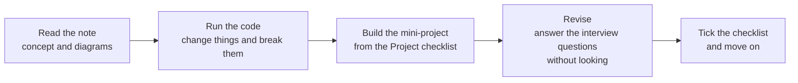

# 📘 The ML Playbook

> *Don't just read about AI. Learn it, build it, revise it.*

A practical, open playbook for learning **AI / Machine Learning**, one roadmap topic at a time. Every topic has clear notes with diagrams, runnable code, common mistakes, interview questions and a **Learn → Project → Revision** checklist. Key topics also have an **interactive HTML page** with live demos.

Maintained by **Tanisha**. Contributions are welcome (see [Contributing](#-contributing)).

---

## ✨ What makes this different

- **Concept first, then code:** each note explains the idea in plain words before the math and code.
- **Visual:** flow diagrams (Mermaid), ASCII sketches, tables and worked numeric examples.
- **Hands-on:** short code you can run, plus a **mini-project** idea for every topic.
- **Interview-ready:** every note ends with questions to test yourself.
- **Interactive pages:** open the `.html` files in a browser for live tokenizers, anchor labs, NMS demos and more.

---

## 🧭 How to use this playbook



1. Read the prerequisites listed at the top of each note.
2. Open the matching interactive page (if there is one) to see the idea move.
3. Run the code and change values.
4. Build the project, then close the note and answer the questions from memory.

---

## 🗺️ Roadmap progress

Based on the **AI/ML Master Roadmap Checklist** (see [Credits](#-credits)).

| # | Section | Status |
|---|---|---|
| 1 | Python Fundamentals | ⬜ Not started |
| 2 | Mathematics | ⬜ Not started |
| 3 | Data Analysis | ⬜ Not started |
| 4 | Data Preprocessing | ⬜ Not started |
| 5 | Machine Learning | ⬜ Not started |
| 6 | Deep Learning | ⬜ Not started |
| 7 | **Computer Vision** | 🟡 In progress (9 of 12 topics) |
| 8 | NLP | ⬜ Not started |
| 9 | Generative AI | ⬜ Not started |
| 10 | **Large Language Models** | ✅ Notes complete (14 of 14 topics) |
| 11 | MLOps | ⬜ Not started |
| 12 | AI Deployment | ⬜ Not started |
| 13 | Projects | ⬜ Not started |
| 14 | Research | ⬜ Not started |
| 15 | Interview Preparation | ⬜ Not started |

---

## 📚 Contents

### 🤖 Section 10: Large Language Models (`10-llm/`)

Suggested reading order is the numbering, with one exception: read **KV Cache (13)** before **Speculative Decoding (14)**, and **LoRA (04)** before **QLoRA (05)**.

| # | Topic | Note | Interactive |
|---|---|---|---|
| 01 | Tokenization | [01_tokenization.md](10-llm/01_tokenization.md) | [Visual guide](10-llm/tokenization_visual_guide.html) |
| 02 | Context Window | [02_context_window.md](10-llm/02_context_window.md) | |
| 03 | Fine-Tuning | [03_fine_tuning.md](10-llm/03_fine_tuning.md) | |
| 04 | LoRA | [04_lora.md](10-llm/04_lora.md) | |
| 05 | QLoRA | [05_qlora.md](10-llm/05_qlora.md) | |
| 06 | PEFT | [06_peft.md](10-llm/06_peft.md) | |
| 07 | RLHF | [07_rlhf.md](10-llm/07_rlhf.md) | |
| 08 | DPO | [08_dpo.md](10-llm/08_dpo.md) | |
| 09 | Quantization | [09_quantization.md](10-llm/09_quantization.md) | |
| 10 | Distillation | [10_distillation.md](10-llm/10_distillation.md) | |
| 11 | Hallucination | [11_hallucination.md](10-llm/11_hallucination.md) | |
| 12 | Context Engineering | [12_context_engineering.md](10-llm/12_context_engineering.md) | |
| 13 | KV Cache | [13_kv_cache.md](10-llm/13_kv_cache.md) | |
| 14 | Speculative Decoding | [14_speculative_decoding.md](10-llm/14_speculative_decoding.md) | |

### 👁️ Section 7: Computer Vision (`07-computer-vision/`)

| # | Topic | Note | Interactive |
|---|---|---|---|
| 01 | OpenCV | [01_opencv.md](07-computer-vision/01_opencv.md) | [Open](07-computer-vision/01_opencv.html) |
| 02 | Image Processing | [02_image_processing.md](07-computer-vision/02_image_processing.md) | |
| 03 | Object Detection | [03_object_detection.md](07-computer-vision/03_object_detection.md) | |
| 04 | YOLO | [04_yolo.md](07-computer-vision/04_yolo.md) | [Open](07-computer-vision/04_yolo.html) |
| 05 | SSD | [05_ssd.md](07-computer-vision/05_ssd.md) | [Open](07-computer-vision/05_ssd.html) |
| 06 | Faster R-CNN | [06_faster_rcnn.md](07-computer-vision/06_faster_rcnn.md) | [Open](07-computer-vision/06_faster_rcnn.html) |
| 07 | Image Segmentation | [07_image_segmentation.md](07-computer-vision/07_image_segmentation.md) | |
| 08 | OCR | [08_ocr.md](07-computer-vision/08_ocr.md) | |
| 09 | Face Recognition | [09_face_recognition.md](07-computer-vision/09_face_recognition.md) | |
| 10 | Pose Estimation | ⏳ Coming soon | |
| 11 | Object Tracking | ⏳ Coming soon | |
| 12 | Image Captioning | ⏳ Coming soon | |

---

## 🌐 Viewing the interactive pages

GitHub shows `.html` files as source code, not as web pages. Two easy options:

1. **Download and open:** save the `.html` file and open it in any browser. It is self-contained, so no internet is needed (except for the outside reference links).
2. **GitHub Pages:** in your repo go to **Settings → Pages**, publish from your main branch, then open the same file paths on your Pages address.

---

## 🧱 Repository structure

```
the-ml-playbook/
├── README.md
├── 07-computer-vision/
│   ├── 01_opencv.md          01_opencv.html
│   ├── 02_image_processing.md
│   ├── 03_object_detection.md
│   ├── 04_yolo.md            04_yolo.html
│   ├── 05_ssd.md             05_ssd.html
│   ├── 06_faster_rcnn.md     06_faster_rcnn.html
│   ├── 07_image_segmentation.md
│   ├── 08_ocr.md
│   └── 09_face_recognition.md
└── 10-llm/
    ├── 01_tokenization.md    tokenization_visual_guide.html
    ├── 02_context_window.md  ...  14_speculative_decoding.md
```
Folder numbers follow the roadmap section numbers.

---

## 🧪 Setup for the code

Python 3.10 or newer is a good baseline. Install only what a note needs.

```bash
# LLM notes
pip install tiktoken transformers datasets peft trl accelerate bitsandbytes

# Computer Vision notes
pip install opencv-python numpy matplotlib ultralytics torch torchvision
pip install easyocr pytesseract            # OCR (Tesseract itself must be installed separately)
pip install face_recognition deepface      # face recognition (face_recognition needs dlib)
```
Use a virtual environment (`python -m venv .venv`) so projects don't clash.

---

## ⚠️ Please read

- **Code is for learning.** Some snippets use placeholders (for example `your-base-model-name`) and library APIs change between versions. Run each snippet once and check the current docs.
- **Numbers from papers** (speeds, accuracies) are quoted as reported in the original papers, on their hardware and setups. Results on your data will differ.
- **Faces and privacy:** if you build anything with face recognition, get consent from every person involved and follow the data-protection rules that apply to you. See `09_face_recognition.md`.
- **Model licenses:** check the license and terms of any model or dataset before using it commercially.

---

## 🤝 Contributing

Found a mistake, a broken link, or a better explanation? Please open an **issue** or **pull request**.

Good contributions:
- Fixes to wrong or unclear explanations
- Better diagrams or worked examples
- New mini-project ideas and solutions
- Notes for roadmap topics that are still ⬜

Keep new notes in the same template: *What is it · How it works · Code · Common mistakes · Interview questions · Checklist · Resources.* Cite your sources.

---

## 🙏 Credits

- Roadmap structure: **AI/ML Master Roadmap Checklist by mdimran.py**
- Concepts follow the original papers, linked at the bottom of each note
- Tools and docs referenced throughout: Hugging Face, PyTorch/torchvision, OpenCV, Ultralytics, Tesseract, EasyOCR, PaddleOCR and the COCO dataset

---

## 📄 License

Released under the **MIT License**. Add a `LICENSE` file to the repo root (GitHub can create it for you when you make the repo).

---

⭐ If this helped you, star the repo and share it with a friend who is learning AI.
