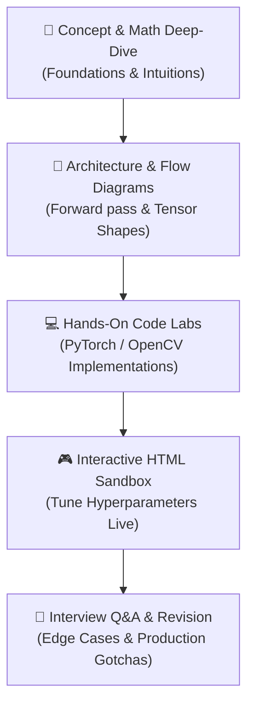

# 📘 The ML Playbook

> *Don't just read about AI — understand it, build it, and master it.*

[](https://github.com/Tanisharma122/The_ML_PlayBook)
[](#-table-of-contents)
[](#-interactive-html-sandboxes)
[](#-curated-curriculum--subject-index)
[](LICENSE)

A practical, production-oriented playbook for learning **Artificial Intelligence**, **Deep Learning**, **Computer Vision**, and **Large Language Models (LLMs)**. Every module combines theoretical intuition, mathematical formulation, PyTorch / OpenCV code implementations, common architectural pitfalls, interview flashcards, and standalone **interactive HTML visual sandboxes**.

Maintained by [**Tanisha Sharma**](https://github.com/Tanisharma122). Contributions, stars ⭐, and feedback are always welcome!

---

## 📌 Table of Contents

- [✨ What Makes This Different](#-what-makes-this-different)
- [🧭 Learning Methodology](#-learning-methodology)
- [📚 Curated Curriculum & Subject Index](#-curated-curriculum--subject-index)
  - [Part 1: 👁️ Computer Vision & Object Recognition](#part-1-️-computer-vision--object-recognition)
  - [Part 2: 🧠 Large Language Models & Modern GenAI](#part-2--large-language-models--modern-genai)
- [🌐 Interactive HTML Sandboxes](#-interactive-html-sandboxes)
- [📂 Verified Repository Structure](#-verified-repository-structure)
- [⚡ Quickstart & Environment Setup](#-quickstart--environment-setup)
- [🤝 Contributing & Community](#-contributing--community)
- [📄 License](#-license)

---

## ✨ What Makes This Different

- **Intuition Before Syntax**: Concepts are explained with real-world analogies and visual schematics before diving into tensors and gradients.
- **Architectural Flowcharts**: Clear Mermaid and ASCII diagrams illustrating forward passes, attention matrices, and loss formulations.
- **Runnable Reference Code**: Self-contained Python snippets with PyTorch, torchvision, Hugging Face `transformers`, `peft`, and OpenCV.
- **Interactive Visualizers**: Standalone HTML/JS applications embedded in the repository to let you interactively experiment with tokenizers, anchor boxes, IoU thresholds, and Non-Maximum Suppression (NMS).
- **Interview & Production Readiness**: Each chapter concludes with battle-tested technical interview questions, trade-off comparisons, and a revision checklist.

---

## 🧭 Learning Methodology



1. **Read the Note**: Understand why the architecture exists and what prior problems it solves.
2. **Launch the Interactive Sandbox**: Open the corresponding `.html` demo in your browser to inspect how varying parameters impact predictions.
3. **Execute & Modify Code**: Run the reference code, alter layer parameters, and examine output shapes.
4. **Test Your Knowledge**: Review the chapter's interview questions and verify your understanding against the checklist.

---

## 📚 Curated Curriculum & Subject Index

### Part 1: 👁️ Computer Vision & Object Recognition

Comprehensive modules spanning foundational image processing to state-of-the-art single-stage and two-stage object detectors and segmentation pipelines.

| # | Architecture / Topic | Study Notes | Interactive Sandbox | Core Concepts & Highlights |
|:---:|:---|:---:|:---:|:---|
| **01** | **OpenCV Fundamentals** | [01_opencv.md](Computer%20Vision/01_opencv/01_opencv.md) | [01_opencv.html](Computer%20Vision/01_opencv/01_opencv.html) | Color spaces (RGB, HSV, Grayscale), 2D convolution kernels, smoothing filters, adaptive thresholding, histogram equalization. |
| **02** | **Image Processing** | [02_image_processing.md](Computer%20Vision/02_image%20processing/02_image_processing.md) | [02_image_processing.html](Computer%20Vision/02_image%20processing/02_image_processing.html) | Sobel & Laplacian gradients, Canny edge detection, morphological transformations (dilation, erosion, opening, closing), contour hierarchy. |
| **03** | **Object Detection Foundations** | [03_object_detection.md](Computer%20Vision/03_object_detection/03_object_detection.md) | [03_object_detection.html](Computer%20Vision/03_object_detection/03_object_detection.html) | Bounding box parameterizations, Intersection over Union (IoU), anchor box priors, Non-Maximum Suppression (NMS), mAP@0.5:0.95. |
| **04** | **YOLO (You Only Look Once)** | [04_yolo.md](Computer%20Vision/04_yolo.md) | [04_yolo.html](Computer%20Vision/04_yolo.html) | Single-shot unified detection, $S \times S$ grid division, multi-part loss function (coordinate, objectness, class), anchor-free evolutions. |
| **05** | **SSD (Single Shot MultiBox)** | [05_ssd.md](Computer%20Vision/05_ssd.md) | [05_ssd.html](Computer%20Vision/05_ssd.html) | Multi-scale feature maps, pyramidal feature hierarchy, default boxes across aspect ratios, hard negative mining (3:1 ratio). |
| **06** | **Faster R-CNN** | [06_faster_rcnn.md](Computer%20Vision/06_faster_rcnn/06_faster_rcnn.md) | [06_faster_rcnn.html](Computer%20Vision/06_faster_rcnn/06_faster_rcnn.html) | Two-stage detection architecture, Region Proposal Network (RPN), RoI Pooling vs. RoIAlign, joint multi-task end-to-end training. |
| **07** | **Image Segmentation** | [07_image_segmentation.md](Computer%20Vision/07_image_segmentation.md) | — | Semantic vs. Instance vs. Panoptic segmentation, Fully Convolutional Networks (FCN), U-Net skip connections, Mask R-CNN mask head. |

#### 🔬 In-Depth Computer Vision Research & Advanced Notes
- [📖 Faster R-CNN Deep Dive Notes](Computer%20Vision/faster_rcnn_study_notes.md) — Comprehensive mathematical walkthrough, RPN loss breakdown, and anchor regression mechanics.
- [📖 Image Segmentation Comprehensive Guide](Computer%20Vision/image_segmentation_study_notes.md) — Encoder-decoder backbones, Dice & Focal loss formulation, transpose convolutions vs bilinear upsampling.
- [📖 Optical Character Recognition (OCR) Notes](Computer%20Vision/ocr_study_notes.md) — Text detection (EAST/DBNet) + recognition (CRNN + CTC loss), integration with Tesseract & EasyOCR pipelines.

---

### Part 2: 🧠 Large Language Models & Modern GenAI

End-to-end coverage of foundational Transformer mechanics, efficient fine-tuning techniques, alignment strategies, and inference acceleration.

| # | Topic | Detailed Guide | Interactive / Visualizer | Technical Highlights |
|:---:|:---|:---:|:---:|:---|
| **01** | **Tokenization** | [01_tokenization.md](Large%20Language%20Models/Large%20Language%20Models/01_tokenization/01_tokenization.md) | [Visual Guide](Large%20Language%20Models/Large%20Language%20Models/01_tokenization/tokenization_visual_guide.html) | Byte-Pair Encoding (BPE), WordPiece, Unigram, SentencePiece, subword token merging algorithms, out-of-vocabulary handling. |
| **02** | **Context Window Scaling** | [02_context_window.md](Large%20Language%20Models/Large%20Language%20Models/02_context_window.md) | — | Quadratic attention bottleneck $\mathcal{O}(N^2)$, Rotary Position Embedding (RoPE), ALiBi, LongLoRA, sliding window attention. |
| **03** | **Fine-Tuning Paradigms** | [03_fine_tuning.md](Large%20Language%20Models/Large%20Language%20Models/03_fine_tuning.md) | — | Full Parameter Tuning vs Parameter-Efficient Tuning (PEFT), Instruction tuning datasets, Catastrophic forgetting mitigation. |
| **04** | **LoRA (Low-Rank Adaptation)** | [04_lora.md](Large%20Language%20Models/Large%20Language%20Models/04_lora.md) | — | Low-rank decomposition $\Delta W = B \cdot A$ ($r \ll d$), scaling factor $\frac{\alpha}{r}$, zero inference latency overhead when merged. |
| **05** | **QLoRA** | [05_qlora.md](Large%20Language%20Models/Large%20Language%20Models/05_qlora.md) | — | 4-bit NormalFloat (NF4), Double Quantization (DQ), Paged Optimizers to manage memory spikes during gradient backward passes. |
| **06** | **PEFT Techniques Overview** | [06_peft.md](Large%20Language%20Models/Large%20Language%20Models/06_peft.md) | — | Prefix Tuning, Prompt Tuning, Bottleneck Adapters, and (IA)$^3$; side-by-side parameter & compute comparison. |
| **07** | **RLHF (Reinforcement Learning from Human Feedback)** | [07_rlhf.md](Large%20Language%20Models/Large%20Language%20Models/07_rlhf.md) | — | Three-stage alignment: SFT, Reward Model training, Proximal Policy Optimization (PPO) with KL-divergence penalty. |
| **08** | **DPO (Direct Preference Optimization)** | [08_dpo.md](Large%20Language%20Models/Large%20Language%20Models/08_dpo.md) | — | Implicit reward modeling via Bradley-Terry objective, eliminating reward model training and complex PPO stability loops. |
| **09** | **Model Quantization** | [09_quantization.md](Large%20Language%20Models/Large%20Language%20Models/09_quantization.md) | — | Post-Training Quantization (PTQ) vs QAT, symmetric/asymmetric quantization, FP8, INT8/INT4, AWQ, GPTQ, and SmoothQuant. |
| **10** | **Knowledge Distillation** | [10_distillation.md](Large%20Language%20Models/Large%20Language%20Models/10_distillation.md) | — | Teacher-student model paradigms, soft targets, temperature scaling, dark knowledge transfer, task-specific compression. |
| **11** | **Hallucination Mitigation** | [11_hallucination.md](Large%20Language%20Models/Large%20Language%20Models/11_hallucination.md) | — | Retrieval-Augmented Generation (RAG), citation grounding, self-consistency sampling, Chain-of-Verification (CoVe). |
| **12** | **Context Engineering** | [12_context_engineering.md](Large%20Language%20Models/Large%20Language%20Models/12_context_engineering.md) | — | Few-shot in-context learning, Chain-of-Thought (CoT), ReAct agent loops, prompt compression, lost-in-the-middle remedies. |
| **13** | **KV Caching** | [13_kv_cache.md](Large%20Language%20Models/Large%20Language%20Models/13_kv_cache.md) | — | Autoregressive decoding acceleration, key-value tensor caching, memory footprint calculations, Multi-Query Attention (MQA) & Grouped-Query Attention (GQA). |
| **14** | **Speculative Decoding** | [14_speculative_decoding.md](Large%20Language%20Models/Large%20Language%20Models/14_speculative_decoding.md) | — | Draft model autoregressive token proposal with fast parallel verification on the target model, lossless speedup guarantees. |

---

## 🌐 Interactive HTML Sandboxes

This repository contains **7 standalone visual laboratories** built with Vanilla HTML/CSS/JavaScript. They allow you to test concepts without installing local dependencies or running GPU servers.

| Sandbox Application | File Path | What You Can Experiment With |
|:---|:---|:---|
| **Tokenization Visualizer** | [`tokenization_visual_guide.html`](Large%20Language%20Models/Large%20Language%20Models/01_tokenization/tokenization_visual_guide.html) | Type text and visualize subword merges, token IDs, and vocabulary lookups in real-time. |
| **OpenCV Interactive Lab** | [`01_opencv.html`](Computer%20Vision/01_opencv/01_opencv.html) | Live image kernel convolutions (Gaussian blur, Sharpen, Emboss), thresholding sliders. |
| **Image Processing Playground** | [`02_image_processing.html`](Computer%20Vision/02_image%20processing/02_image_processing.html) | Interactive Canny edge detector with high/low threshold tuning, dilation and erosion. |
| **Object Detection & NMS Lab** | [`03_object_detection.html`](Computer%20Vision/03_object_detection/03_object_detection.html) | Adjust IoU overlap thresholds and confidence scores to see how Non-Maximum Suppression filters boxes. |
| **YOLO Explorer** | [`04_yolo.html`](Computer%20Vision/04_yolo.html) | Inspect $S \times S$ grid cells, anchor offset regressions, and multi-box confidence scores. |
| **SSD Multi-Scale Anchor Lab** | [`05_ssd.html`](Computer%20Vision/05_ssd.html) | Visualize default anchor boxes across varying aspect ratios and pyramidal feature map depths. |
| **Faster R-CNN Architecture Lab** | [`06_faster_rcnn.html`](Computer%20Vision/06_faster_rcnn/06_faster_rcnn.html) | Step through Backbone &rarr; RPN proposal generation &rarr; RoI Pooling &rarr; Classification. |

> **💡 How to run them:**
> 1. Clone or download the repository.
> 2. Double-click any `.html` file to launch it directly in Chrome, Edge, Safari, or Firefox — zero build tools required!
> 3. Alternatively, host the repository using **GitHub Pages** (Settings &rarr; Pages &rarr; Source: `main` branch).

---

## 📂 Verified Repository Structure

```
The_ML_PlayBook/
│
├── 📁 Computer Vision/
│   ├── 📁 01_opencv/
│   │   ├── 📄 01_opencv.md
│   │   └── 🌐 01_opencv.html
│   ├── 📁 02_image processing/
│   │   ├── 📄 02_image_processing.md
│   │   └── 🌐 02_image_processing.html
│   ├── 📁 03_object_detection/
│   │   ├── 📄 03_object_detection.md
│   │   └── 🌐 03_object_detection.html
│   ├── 📁 06_faster_rcnn/
│   │   ├── 📄 06_faster_rcnn.md
│   │   └── 🌐 06_faster_rcnn.html
│   ├── 📄 04_yolo.md
│   ├── 🌐 04_yolo.html
│   ├── 📄 05_ssd.md
│   ├── 🌐 05_ssd.html
│   ├── 📄 07_image_segmentation.md
│   ├── 📄 faster_rcnn_study_notes.md
│   ├── 📄 image_segmentation_study_notes.md
│   └── 📄 ocr_study_notes.md
│
├── 📁 Large Language Models/
│   └── 📁 Large Language Models/
│       ├── 📁 01_tokenization/
│       │   ├── 📄 01_tokenization.md
│       │   └── 🌐 tokenization_visual_guide.html
│       ├── 📄 02_context_window.md
│       ├── 📄 03_fine_tuning.md
│       ├── 📄 04_lora.md
│       ├── 📄 05_qlora.md
│       ├── 📄 06_peft.md
│       ├── 📄 07_rlhf.md
│       ├── 📄 08_dpo.md
│       ├── 📄 09_quantization.md
│       ├── 📄 10_distillation.md
│       ├── 📄 11_hallucination.md
│       ├── 📄 12_context_engineering.md
│       ├── 📄 13_kv_cache.md
│       └── 📄 14_speculative_decoding.md
│
└── 📄 README.md
```

---

## ⚡ Quickstart & Environment Setup

### 1. Clone the Repository
```bash
git clone https://github.com/Tanisharma122/The_ML_PlayBook.git
cd The_ML_PlayBook
```

### 2. Create a Virtual Environment
```bash
python -m venv .venv

# On Windows (PowerShell):
.venv\Scripts\Activate.ps1

# On Linux / macOS:
source .venv/bin/activate
```

### 3. Install Dependencies
```bash
# Core Machine Learning & Computer Vision
pip install numpy matplotlib opencv-python pillow torchvision ultralytics

# Large Language Models & PEFT Ecosystem
pip install torch transformers datasets peft trl accelerate bitsandbytes tiktoken

# Optional: OCR & Specialized Vision Tools
pip install easyocr pytesseract
```

---

## 🤝 Contributing & Community

Contributions are what make the open-source AI community an inspiring place to learn and build!

- **Found a typo or a broken explanation?** Open a PR or submit an issue.
- **Want to add a new mini-project or worked example?** Fork the repository and send your additions!
- **Star this repository ⭐:** If these notes or visualizers assist your machine learning journey, giving a star helps others discover the playbook!

---

## 📄 License

This repository is distributed under the **MIT License**. Feel free to use, modify, and reference these notes for academic, personal, or interview prep purposes.

---

<p align="center">
  <b>Built with passion for machine learning learners worldwide 🚀</b><br>
  <i>Crafted by <a href="https://github.com/Tanisharma122">Tanisha Sharma</a></i>
</p>
